# Diagrammi di Nando

> **Stato:** bozza di lavoro, generata dagli ADR 0001–0018 il 2026-10-29 e aggiornata con ADR-0022 il 2026-11-06.
> La fonte di verità resta `docs/adr/`. Se una decisione cambia, il diagramma va rigenerato o cancellato: un diagramma vecchio è peggio di nessun diagramma.

Indice:

1. [Livelli e dipendenze](#1-livelli-e-dipendenze)
2. [Topologia di deploy](#2-topologia-di-deploy)
3. [Richiesta HTTP e streaming](#3-richiesta-http-e-streaming)
4. [Workspace e confini](#4-workspace-e-confini)
5. [Modello dati: kernel e core](#5-modello-dati-kernel-e-core)
6. [Modello dati: Tasks e Calendar](#6-modello-dati-tasks-e-calendar)
7. [Modello dati: Knowledge](#7-modello-dati-knowledge)
8. [Modello dati: Habits](#8-modello-dati-habits)
9. [Modello dati: AI e policy](#9-modello-dati-ai-e-policy)
10. [Macchine a stati](#10-macchine-a-stati)
11. [Flusso: completare un task](#11-flusso-completare-un-task)
12. [Flusso: check-in manuale e dedup](#12-flusso-check-in-manuale-e-dedup)
13. [Flusso: scrivere un documento](#13-flusso-scrivere-un-documento)
14. [Flusso: ricerca e retrieval](#14-flusso-ricerca-e-retrieval)
15. [Flusso: proposta AI](#15-flusso-proposta-ai)
16. [Ciclo di vita: deletion, purge, retention](#16-ciclo-di-vita-deletion-purge-retention)
17. [Backup, restore, export](#17-backup-restore-export)
18. [Accesso e autenticazione](#18-accesso-e-autenticazione)
19. [Ticket aperti e roadmap](#19-ticket-aperti-e-roadmap)

---

## 1. Livelli e dipendenze

ADR-0005. Il core non conosce le capability; le capability usano il core tramite porte; la piattaforma è sostituibile.

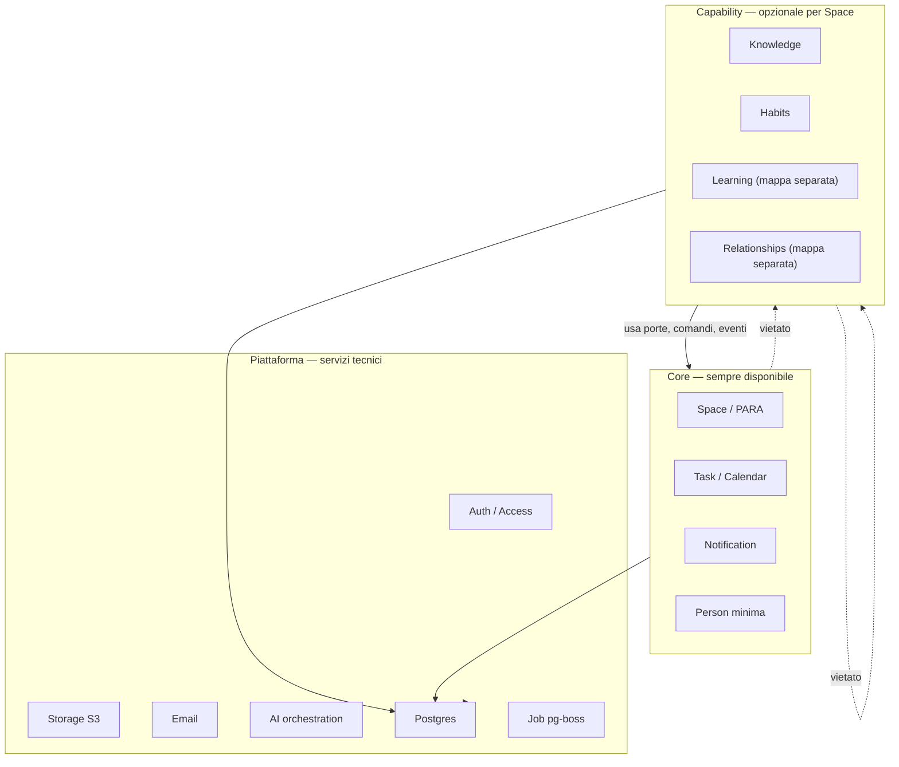

---

## 2. Topologia di deploy

ADR-0009, ADR-0010, ADR-0012.

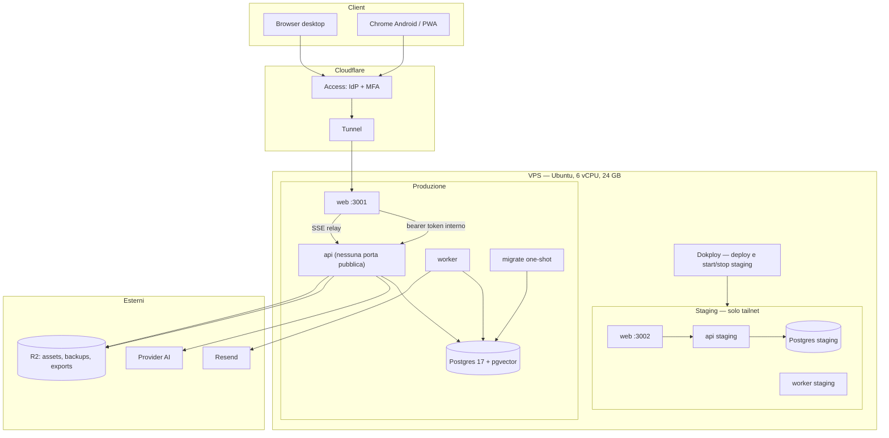

---

## 3. Richiesta HTTP e streaming

ADR-0010, ADR-0012, ADR-0016, ADR-0022. Un solo origin per il browser; l'API non è raggiungibile dall'esterno.

```mermaid
sequenceDiagram
    autonumber
    participant B as Browser
    participant A as Cloudflare Access
    participant W as web
    participant P as api
    participant D as Postgres

    B->>A: GET nando.giovannicosta.me
    A->>A: sessione Access valida?
    A-->>B: redirect al login se assente
    A->>W: richiesta autenticata
    W->>W: SSR con TanStack Start
    W->>P: proxy /api/*, Authorization bearer
    P->>D: query con scope applicativo
    D-->>P: righe
    P-->>W: JSON
    W-->>B: HTML + hydration

    Note over B,W: browser usa /api/*; SSR chiama api direttamente

    Note over B,W: streaming
    B->>W: GET /events (SSE)
    W->>P: stream SSE interno
    P-->>W: eventi
    W-->>B: relay senza buffering

    Note over W,P: /api/reference e /api/openapi.json passano dallo stesso proxy
```

---

## 4. Workspace e confini

ADR-0010. Otto workspace; il grafo dei pacchetti è il vincolo architetturale.

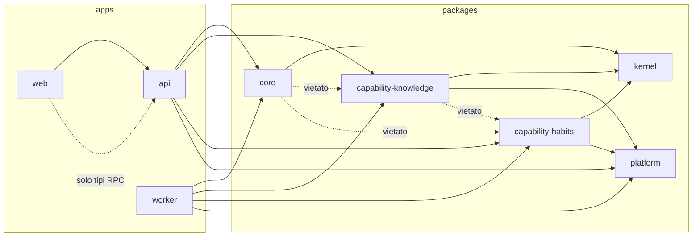

---

## 5. Modello dati: kernel e core

ADR-0001, ADR-0002, ADR-0003, ADR-0017. `EntityRef` è un valore, non una tabella.

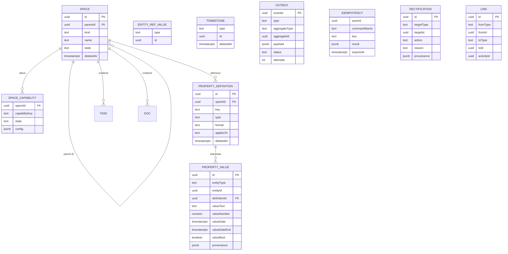

---

## 6. Modello dati: Tasks e Calendar

ADR-0004, ADR-0006. Lo stato vive sull'occorrenza; il Task non ha stato di esecuzione.

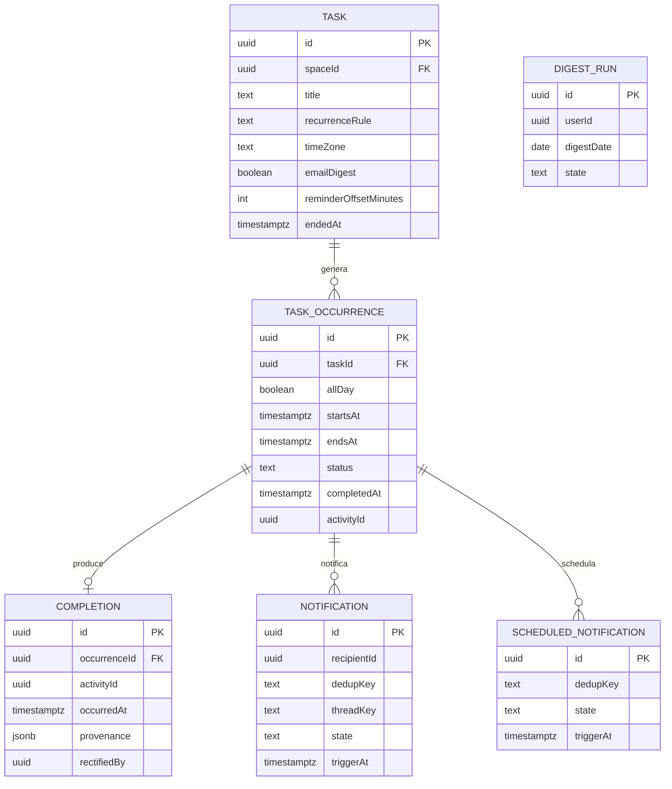

---

## 7. Modello dati: Knowledge

ADR-0016, ADR-0018. Il documento è la verità; `block` è un indice derivato e ricostruibile. I wikilink vivono dentro il JSON come nodi, non in una tabella.

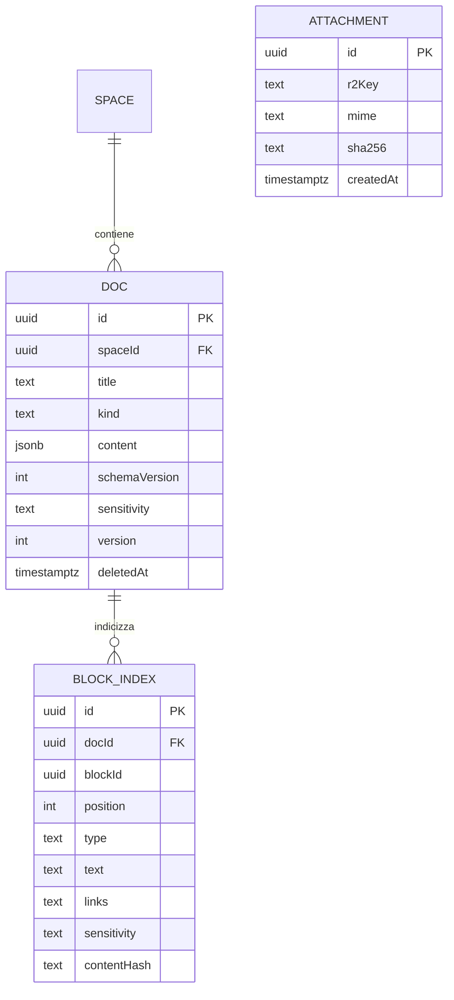

Note:

- `DOC.kind` = `page` | `note`. Una nota è un documento referenziato da un'entità con `EntityRef`.
- `BLOCK_INDEX.links` contiene i `docId` risolti dei wikilink: i backlink sono una query, non una scansione.
- Un wikilink rotto non ha `docId` e non entra in `links`.
- `ATTACHMENT` non è nel documento: il nodo immagine porta solo `attachmentId`.

---

## 8. Modello dati: Habits

ADR-0014, ADR-0015, ADR-0019. Nessuna tabella periodo: il periodo è derivato da configurazione, tempo e timezone.

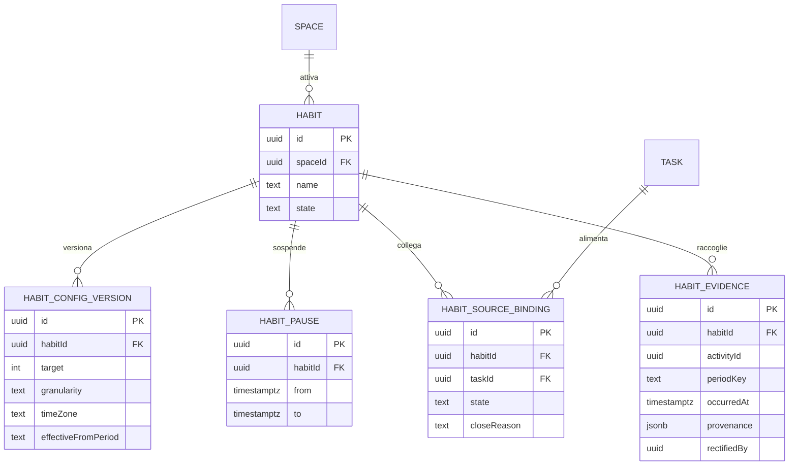

Derivati a runtime, senza tabella: periodo (`periodKey`), stato del periodo (`met`, `missed`, `paused`, `not_evaluated`), forza dell'abitudine (`strength`, campionata a fine periodo), streak, aggregati per Area e globale.

---

## 9. Modello dati: AI e policy

ADR-0007, ADR-0008. La `PolicyDecision` è immutabile per turno; le Proposal non sono dominio.

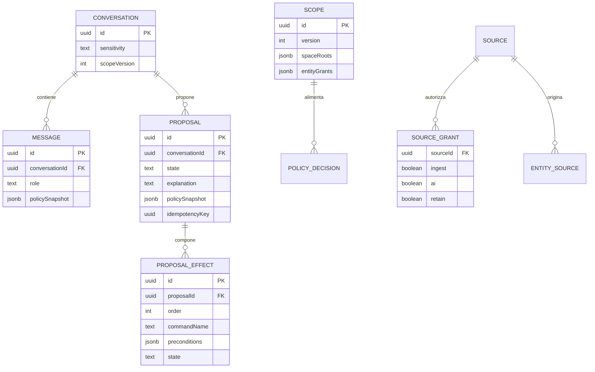

---

## 10. Macchine a stati

### 10.1 Occorrenza di un task

ADR-0004. Le transizioni sono terminali; la riapertura passa da una rettifica.

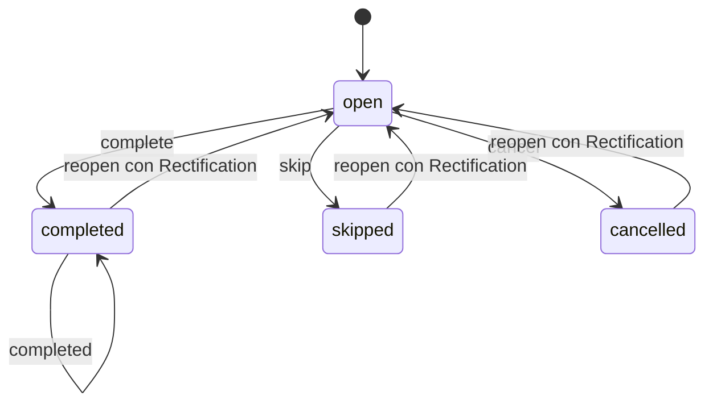

### 10.2 Periodo di un habit

ADR-0014. Derivato, non memorizzato come macchina a stati.

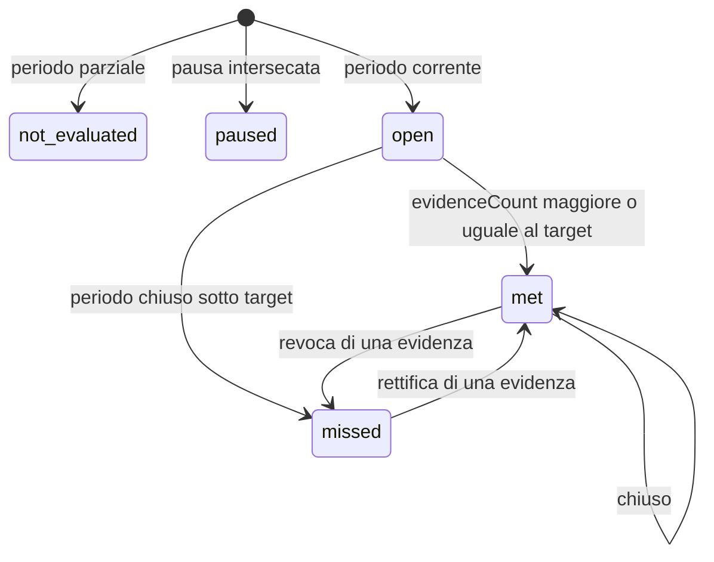

### 10.3 Binding di un habit

ADR-0015.

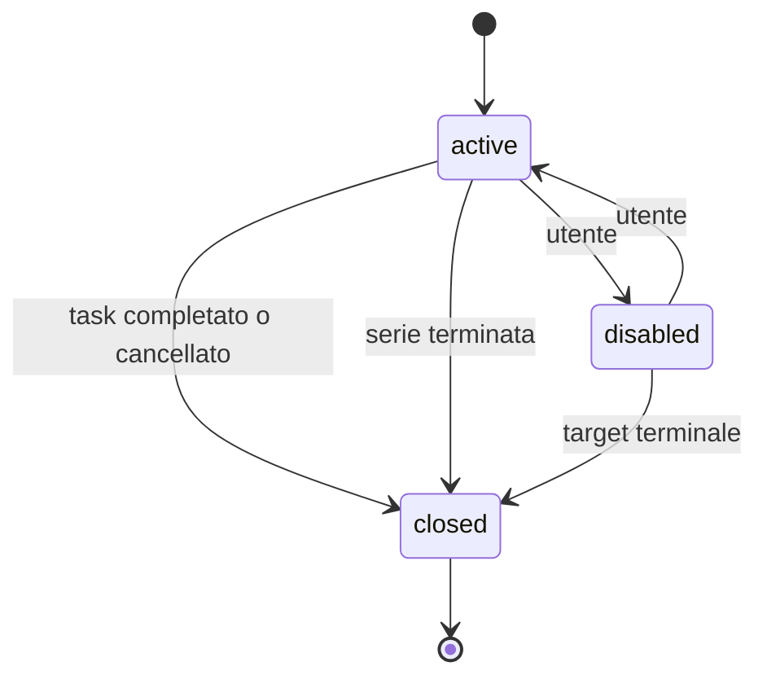

### 10.4 Proposal

ADR-0007.

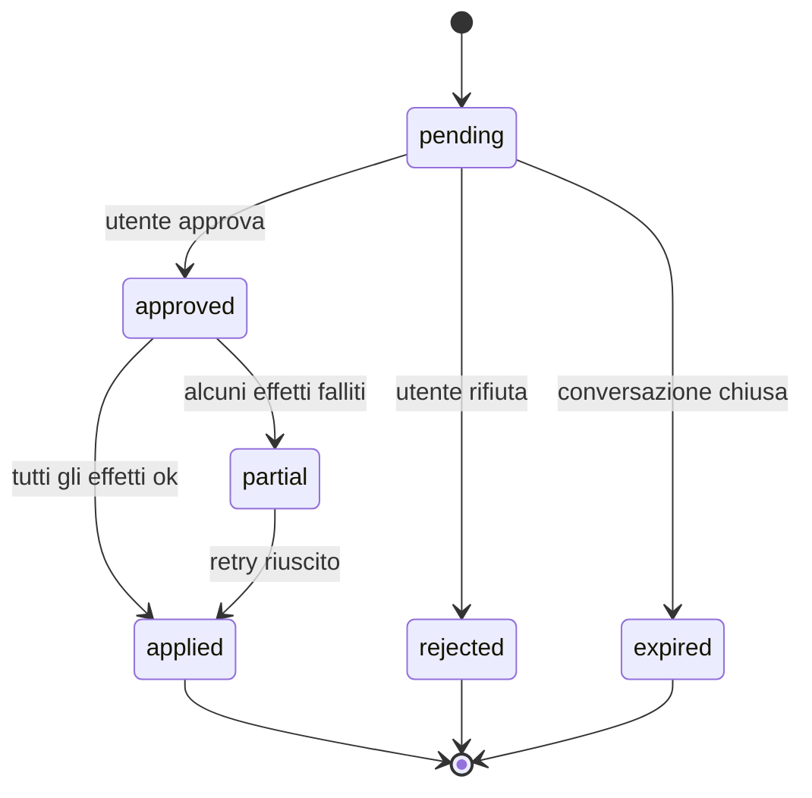

---

## 11. Flusso: completare un task

ADR-0004, ADR-0006, ADR-0015. Il caso guida "compra fiori": un task, un'evidenza, una notifica risolta.

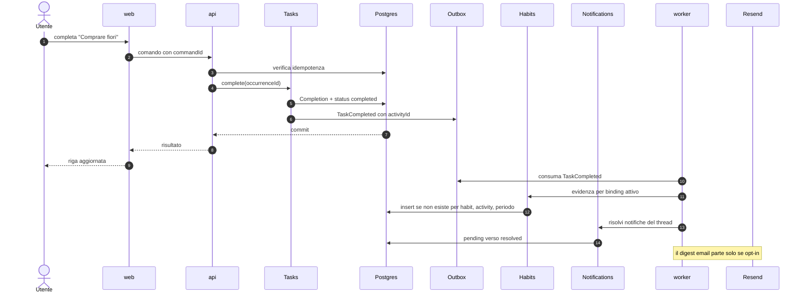

---

## 12. Flusso: check-in manuale e dedup

ADR-0014, ADR-0015. Due azioni vere nello stesso giorno sono due; la stessa attività esterna è una.

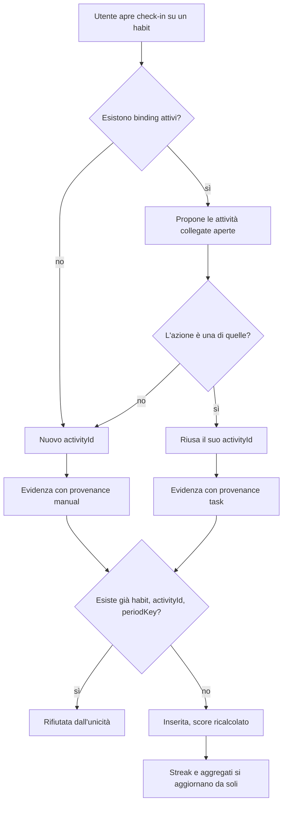

---

## 13. Flusso: scrivere un documento

ADR-0016, ADR-0018. Una sola transazione: documento e indice dei blocchi non possono divergere.

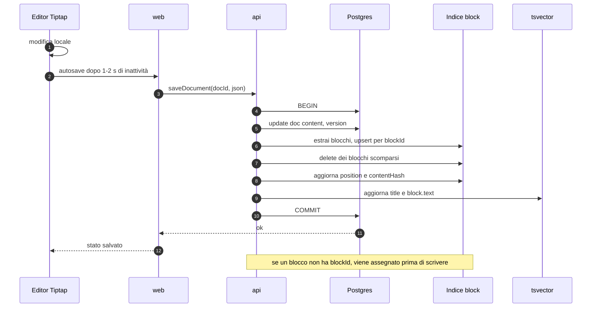

---

## 14. Flusso: ricerca e retrieval

ADR-0018, ADR-0008. La ricerca umana vede tutto; l'AI no.

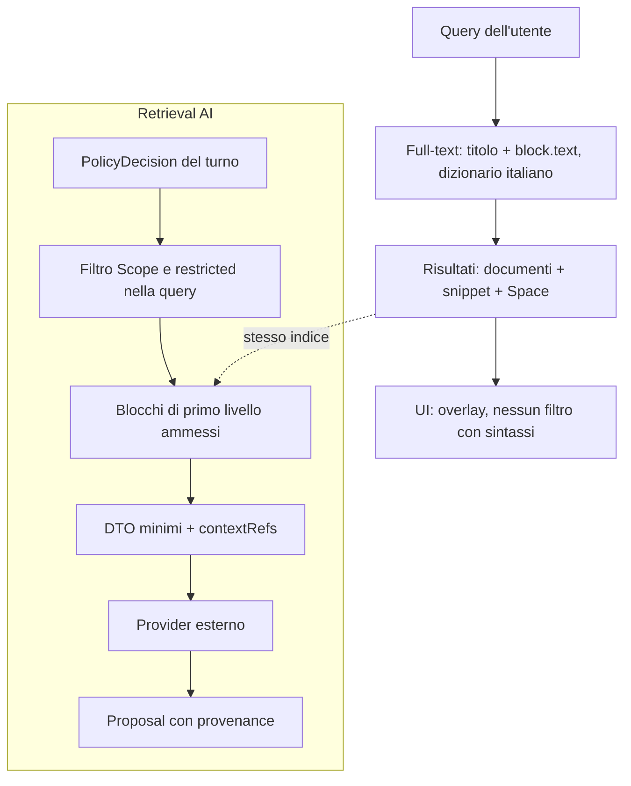

---

## 15. Flusso: proposta AI

ADR-0007, ADR-0008. Nessuna scrittura senza approvazione; applicazione per effetto.

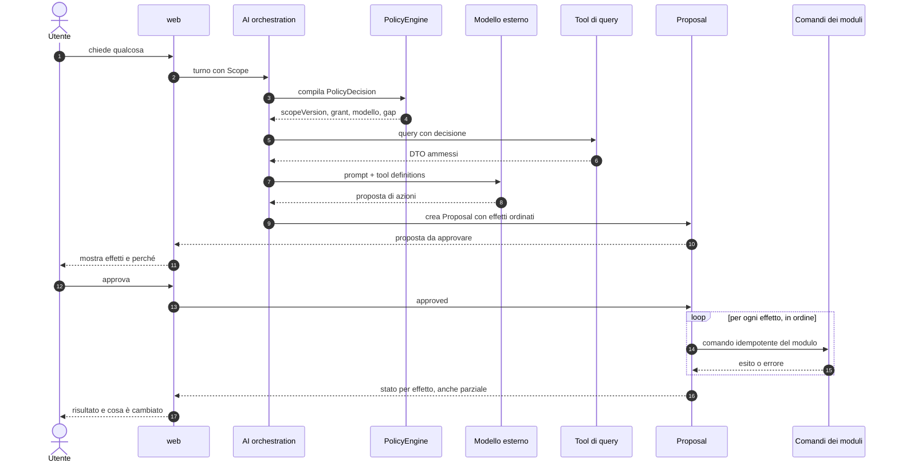

---

## 16. Ciclo di vita: deletion, purge, retention

ADR-0011. La cancellazione nasconde subito; la purge arriva dopo sette giorni; il tombstone resta.

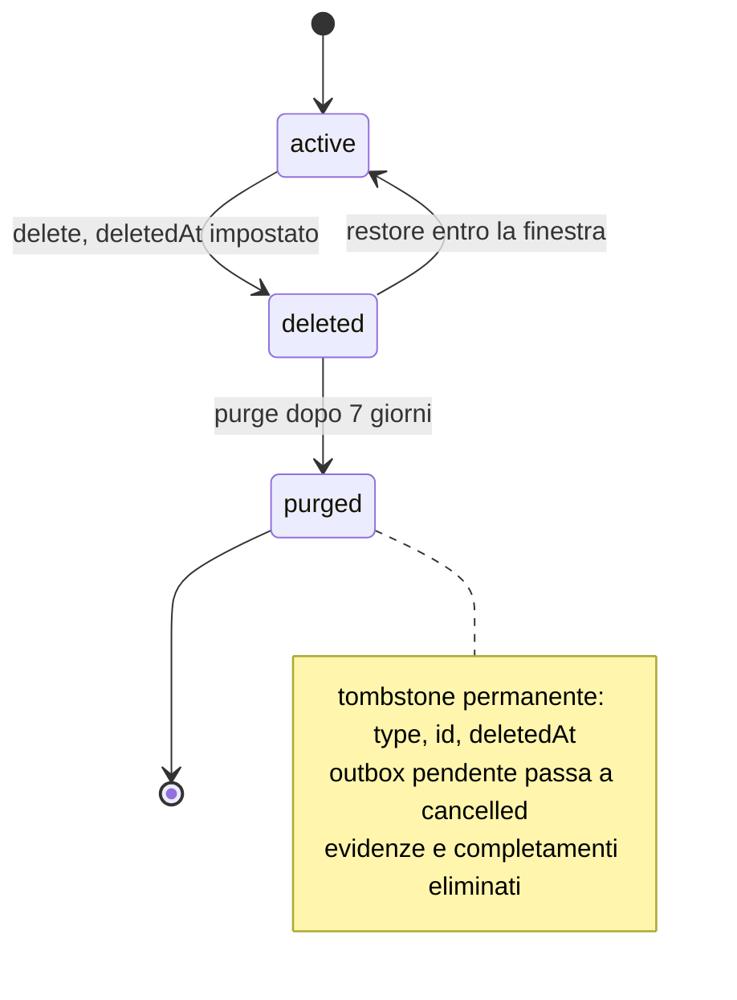

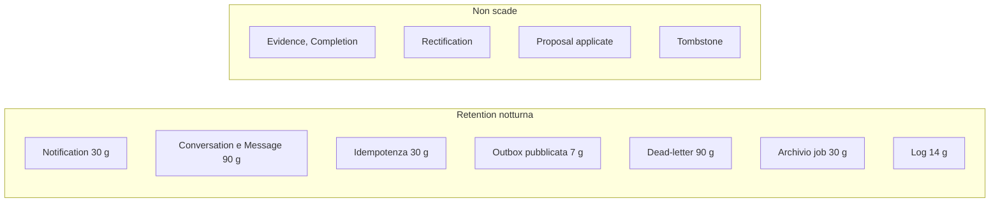

---

## 17. Backup, restore, export

ADR-0011, ADR-0009. Il dump è il backup; l'export è il contratto leggibile.

```mermaid
flowchart TB
    subgraph BACKUP["Backup giornaliero — 03:00 UTC"]
        T1["systemd timer"] --> D1["pg_dump -Fc"]
        D1 --> R1["restic su R2"]
        R1 --> H1["healthchecks.io"]
        R1 --> K1["30 giornalieri, 12 settimanali, 12 mensili"]
    end

    subgraph EXPORT["Export — on demand e mensile"]
        E1["pnpm export / comando in app"] --> E2["database.dump"]
        E2 --> E3["schema.sql derivato dal dump"]
        E3 --> E4["MANIFEST con commit, tag, journal, checksum"]
        E4 --> E5["allegati da R2"]
        E5 --> E6["archivio cifrato con age"]
        E6 --> E7["bucket nando-exports, 12 archivi"]
    end

    subgraph RESTORE["Restore — RTO 2-4 h"]
        Z1["Postgres pgvector"] --> Z2["pg_restore --clean"]
        Z2 --> Z3["/srv/nando da restic"]
        Z3 --> Z4["tag immagine dal manifest"]
        Z4 --> Z5["verifica conteggi e health"]
    end
```

---

## 18. Accesso e autenticazione

ADR-0012. Un cancello per ambiente; l'app non ha login.

```mermaid
flowchart TD
    subgraph PROD["Produzione"]
        B1["Browser o PWA"] --> A1["Cloudflare Access<br/>IdP + PIN + MFA"]
        A1 --> W1["web"]
        W1 -->|"bearer token"| P1["api"]
    end

    subgraph STAGE["Staging"]
        B2["Dispositivo nel tailnet"] --> TS["tailscale serve"]
        TS --> W2["web :3002"]
        W2 -->|"bearer token"| P2["api staging"]
    end

    subgraph BREAK["Break-glass"]
        B3["SSH via Tailscale"] --> PF["port-forward 3001"]
        PF --> W1
    end

    subgraph NOPE["Non esiste"]
        X1["login applicativo"]
        X2["sessione in app"]
        X3["api pubblica"]
    end
```

---

## 19. Ticket aperti e roadmap

Stato al 2026-11-05. La roadmap NAS-53 parte quando i suoi blocchi sono chiusi.

```mermaid
flowchart LR
    subgraph DONE["Decisioni chiuse"]
        D1["NAS-51 repo e processi"]
        D2["NAS-47 persistenza"]
        D3["NAS-50 autenticazione"]
        D4["NAS-45 scope v1"]
        D5["NAS-61 e NAS-63 Habits"]
        D6["NAS-54 e NAS-59 Knowledge"]
        D7["NAS-129 forza dell'abitudine"]
        D8["NAS-103 test, CI e ambienti"]
    end

    subgraph OPEN["Aperti"]
        O1["NAS-62 mock di riferimento"]
        O2["NAS-60 UI Habits"]
    end

    subgraph HUMAN["Lavoro umano sull'infrastruttura"]
        H1["NAS-102 doc e compose a tre processi"]
        H2["NAS-104 backup allegati e chiave age"]
        H3["NAS-105 Access, MFA, break-glass"]
    end

    subgraph NEXT["Prossimo"]
        R["NAS-53 roadmap v1"]
    end

    O1 --> R
    O2 --> R
    H1 -.->|"non blocca"| R
    H2 -.->|"non blocca"| R
    H3 -.->|"non blocca"| R
    D1 --> R
    D2 --> R
    D7 --> O2
    D8 --> R
```

---

## Dove vive la verità

| Dato | Verità | Derivato |
| --- | --- | --- |
| Documento | `doc.content` JSON ProseMirror | indice `block`, tsvector, backlink |
| Periodo di un habit | configurazione + tempo + timezone | stato, score, streak, aggregati |
| Forza di un habit | configurazione + tempo + timezone + evidenze non rettificate | `strength` 0–1, campionata a fine periodo |
| Occorrenza di un task | `TaskOccurrence` | `overdue`, viste Calendar |
| Evidenza | `HabitEvidence` non rettificata | score del periodo, forza |
| Notifica | `Notification` e `ScheduledNotification` | badge, centro notifiche |
| Backup | dump + restic | export leggibile |
| Proprietà | `PropertyDefinition` + `PropertyValue` | colonne delle schermate |
| Configurazione deploy | compose nel repository | copia live `/srv/nando` |
